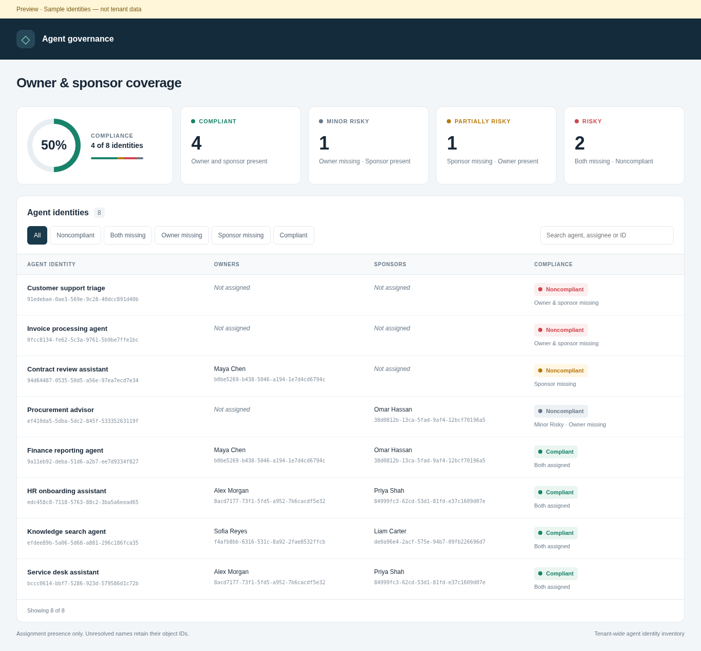

# Microsoft Entra Agent Identity Governance Assessment

A PowerShell-based assessment I built to identify Microsoft Entra agent identities with missing owners or sponsors.

The script queries Microsoft Graph, checks both assignments for each agent identity, and generates CSV reports and a local HTML dashboard. It does not add, remove, or change any assignments.



*The screenshot and [HTML preview](AgentIdentity-Dashboard-Preview.html) use sample identities, not tenant data.*

## What it checks

The assessment covers agent identity objects in the current Microsoft Entra tenant, including identities created through Microsoft Foundry when represented as Entra agent identities. It retrieves assigned owners and sponsors, resolves their display names where permitted, and flags missing assignments.

| Result | Owner | Sponsor | Assessment status |
| --- | --- | --- | --- |
| Complete | Assigned | Assigned | Compliant |
| Minor Risky | Missing | Assigned | Noncompliant |
| Partially risky | Assigned | Missing | Noncompliant |
| Risky | Missing | Missing | Noncompliant |

**My assessment rule:** An identity is compliant only when at least one owner **and** one sponsor are assigned. Microsoft requires sponsors for agent identities, while owners are optional. Requiring both is the governance baseline used by this script, not a Microsoft-enforced compliance policy. The labels above are my reporting categories, not official Microsoft risk classifications.

This is an assignment-presence check. It does not evaluate whether an assignee is appropriate, whether an assigned group still has active members, or whether the agent's permissions are secure.

## Requirements

- PowerShell 7.0 or later.
- `Microsoft.Graph.Authentication` PowerShell module.
- A Microsoft Entra app registration with a certificate **or** a supported Azure-hosted system-assigned managed identity.
- Microsoft Graph **application permissions** with admin consent.
- Access to the Microsoft Graph v1.0 endpoints used by the script.

Install the required module:

```powershell
Install-Module Microsoft.Graph.Authentication -Scope CurrentUser
```

### Microsoft Graph permissions

Assign the following **Application permissions** to the app registration or managed identity:

| Permission | Used for |
| --- | --- |
| `AgentIdentity.ReadWrite.All` | Required to list agent identity sponsors using the current Microsoft Graph v1.0 API; also covers agent identity enumeration. |
| `Application.Read.All` | Reading agent identity owners and resolving service principal names. |
| `User.Read.All` | Resolving user display names. |
| `GroupMember.Read.All` | Resolving group display names. |

`Directory.Read.All` may also be needed to resolve less common directory object types through the script's fallback lookup. If a name cannot be resolved, the report keeps the object's ID and logs a warning; the assignment is still counted.

**Permission caveat:** Although this script only sends `GET` requests to Microsoft Graph, Microsoft's *list agentIdentity sponsors* API currently requires `AgentIdentity.ReadWrite.All` as an **application** permission. Delegated permissions are not supported for that endpoint. Treat the execution identity as privileged and secure its credentials accordingly, hence recommending certificate-based auth. 

To grant permissions for an app registration, open **Microsoft Entra admin center > Entra ID > App registrations > [your app] > API permissions > Add a permission > Microsoft Graph > Application permissions**. Add the permissions above and select **Grant admin consent**. For certificate authentication, upload the public certificate under **Certificates & secrets > Certificates**. Keep the private key secure.

For a managed identity, the corresponding Microsoft Graph app roles must be assigned to its service principal by an administrator; app registration instructions do not apply directly to managed identities.

## Run the assessment

### Option 1 — App registration and certificate

Make sure the signing certificate, including its private key, is available in a certificate store accessible to Microsoft Graph PowerShell on the machine where you run the script.

```powershell
./Get-AgentIdentityCompliance.ps1 `
    -TenantId '<tenant-id>' `
    -ClientId '<application-client-id>' `
    -CertificateThumbprint '<certificate-thumbprint>' `
    -OutputDirectory './Reports'
```

`-OutputDirectory` is optional. If omitted, the reports are written to the current working directory.


### Option 2 — System-assigned managed identity

Run from an Azure environment that provides a system-assigned managed identity with the required Microsoft Graph app-role assignments (for example, an appropriately configured Azure Automation environment).

```powershell
./Get-AgentIdentityCompliance.ps1 `
    -ManagedIdentity `
    -OutputDirectory './Reports'
```

## Output

Each run produces three files in the selected output directory:

| File | Content |
| --- | --- |
| `AgentIdentity-Inventory.csv` | All agent identities returned by the tenant assessment, including counts, names, object IDs, and status. |
| `AgentIdentity-Noncompliant.csv` | Agent identities missing an owner, a sponsor, or both. |
| `AgentIdentity-Dashboard.html` | A standalone, offline HTML dashboard with assessment totals, search, filters, and individual assignment details. |

The script follows Microsoft Graph pagination. It creates both CSV files with headers even if no identities or findings are returned. An API error during identity or relationship retrieval stops the assessment rather than treating an unsuccessful request as an empty assignment.


## Disclaimer

I provide this script **as-is**, without warranty or guarantee of fitness for a particular purpose. Use it at your own discretion and validate its output before relying on it for governance or compliance decisions.

I am not responsible for changes made by third parties, or for any behavior, errors, or outcomes resulting from those modifications. Any modified version is outside the scope of my original release and responsibility.

**Author:** Rojan Koc
